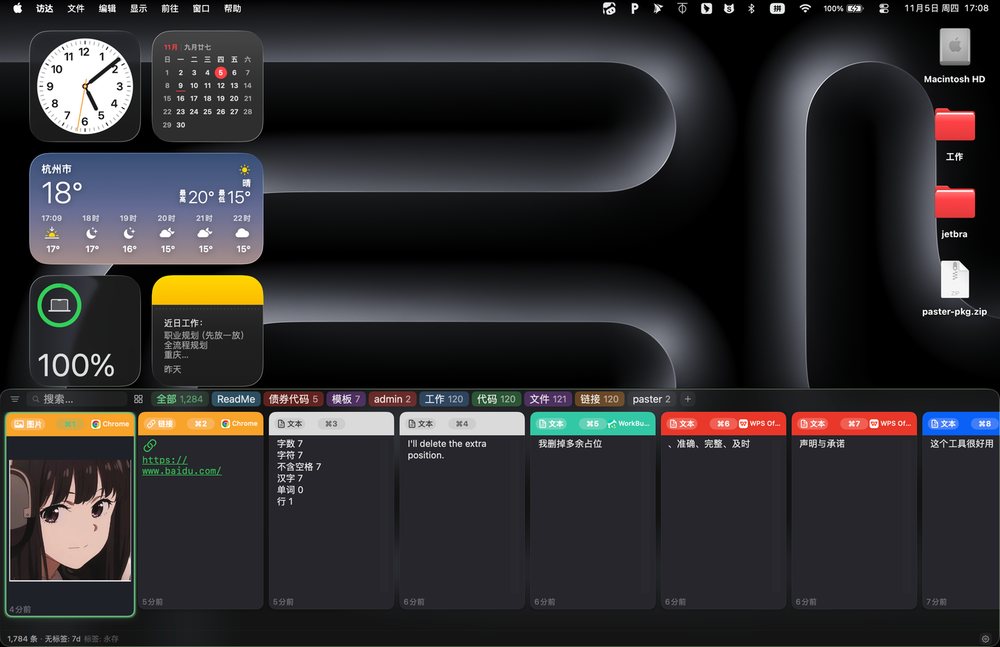

# Paster

macOS 菜单栏剪贴板历史。复制过的文字、图片、链接和文件留在本机，选中一条就能贴回刚才的窗口。

需要 macOS 14 或更高版本，Apple Silicon（arm64）。

## 安装

到 [Releases](https://github.com/xiaoxiamiya/paster-pkg/releases) 下载安装包。当前版本是 **1.4**：

[Paster-1.4.pkg](https://github.com/xiaoxiamiya/paster-pkg/releases/download/v1.4/Paster-1.4.pkg)

下载后双击，按向导安装。装完后从「应用程序」打开。Paster 不出现在程序坞，看屏幕顶部菜单栏里的剪贴板图标。

默认按 **⇧⌘V** 打开底部面板。选中记录后要自动粘贴到原来的窗口，需要在 **系统设置 → 隐私与安全性 → 辅助功能** 里允许 Paster。

用法、快捷键和常见问题见 [使用说明](docs/使用说明.md)。

## 版本

每个版本的安装包在 [Releases](https://github.com/xiaoxiamiya/paster-pkg/releases)，对应的更新说明在 [更新记录](CHANGELOG.md)。

## 许可证

[Apache License 2.0](LICENSE)

## 请作者喝杯咖啡吧～

Paster 完全免费。没有内购，没有广告，剪贴板只留在本机，不会上传。

如果它帮你省下了一点时间，欢迎请我喝杯咖啡。

赞赏出于自愿，与功能、更新和技术支持无关，也不构成购买或服务约定。

虾米哥呀的赞赏码
